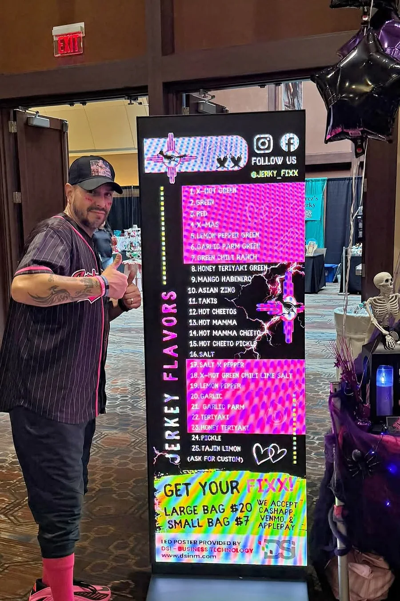

Hi, it's Aaliyah. We're still recovering, but in the best way. On Halloween night, Saturday, October 31, my family brought Jerky Fixx to the 4th annual New Mexico Jerky Fest at Isleta Resort and Casino, and the energy was honestly insane. If you came by the booth, thank you. If you missed it, here's the recap.

## A Halloween edition of Jerky Fest

This year's Jerky Fest had a Halloween theme, and people went all in. We saw full costumes, face paint, matching crews and kids dragging their parents from table to table. My parents, Joseph and Sabrina, rocked matching pinstripe Jerky Fixx jerseys with face paint to match. The booth had pink, purple and black balloons, spiderwebs, a skull chalkboard that says "God provides, we prepare, you enjoy" and a bowl of candy for the trick or treaters.

Our two bull skull trophies from past Jerky Fests made the trip too, front and center on the table.

@video(/vid/blog/jerky-fest-2026-booth-walkthrough.mp4, /vid/blog/jerky-fest-2026-booth-walkthrough.jpg) A quick walk through the Jerky Fixx booth at Jerky Fest.

## A flavor board that lit up the room

The biggest upgrade this year was our flavor board. [DSI, Document Solutions, Inc.](https://www.dsinm.com/) sponsored the Jerky Fixx booth with one of their dynamic LED digital signage displays, and it stopped people in their tracks. It showed all 25 flavors, from X-Hot Green down to Tajin Limon, with our bag prices and how to pay.

DSI's marketing specialist, Toni Torivio, made the animated slideshows that ran on it. They were bright, loud and full of color, which is exactly how our carne seca tastes. Watching people stand in front of it and point at the flavors they wanted was one of my favorite parts of the night.

 | The DSI LED sign with every flavor on it. Dad approved.

The display also had a QR code, so anyone could scan it and land right on our brand new website, built by [DYAD Marketects](https://www.dyadgrow.com/). If that's how you found this page, welcome. You can browse the [full menu](/jerky/), save your favorites and [order](/contact/) whenever the craving hits.

## Why a sign like that matters for a small business

For a family business like ours, a booth is everything. You've got a few seconds while people walk past to show them who you are. A glowing sign that cycles through every flavor does that job for you, and it answers the first two questions everybody asks: what flavors do you have, and how much is a bag. It also meant my parents could spend less time reading the menu out loud and more time handing out samples and talking with people. Seeing our roadrunner logo and lightning animated that big was pretty special for our whole family.

## What people kept asking for

We sampled a lot of carne seca. The heat chasers went straight for X-Hot Green and Hot Cheetos, the families loved Honey Teriyaki and Garlic Parm, and Hot Cheeto Pickle got the usual "wait, pickle?" right before people bought a bag anyway. A lot of folks also met our spiciest new mix, Hot Mamma Cheeto, for the first time. I wrote more about how we come up with flavors like that in [our flavor engineering post](/blog/flavor-engineering-for-burquenos/).

@video(/vid/blog/jerky-fest-2026-recap.mp4, /vid/blog/jerky-fest-2026-recap.jpg) Jerky Fest 2026 in one quick reel.

## Thank you, Burque

Events like Jerky Fest are why we do this. Jerky Fest always feels like a family reunion with way more jerky, and we loved seeing so many returning faces next to brand new fiends. Thank you to everyone who stopped by, tried a sample, took a picture in their costume or told us about their favorite flavor. Thank you to the Jerky Fest team and Isleta Resort and Casino for hosting, and a huge thank you to DSI and Toni for making our booth glow.

## Where to find us next

Jerky Fest is a wrap, so stay tuned for upcoming events. Follow us on [Instagram](https://www.instagram.com/jerky_fixx/) and Facebook, or check the [dealer locator](/dealer-locator/) for our next stop. Can't wait that long? Small bags are $7 and large bags are $20, and you can [order direct](/contact/) for door drop off around Albuquerque and Rio Rancho.
