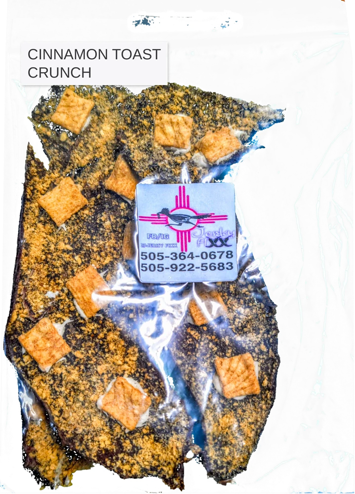

Hi, it's Aaliyah. Our menu has 25 flavors, and most people find their bag somewhere on it. But every so often somebody walks up to the booth or texts my parents with an idea that isn't on the board. Sometimes it's a flavor from a favorite snack. Sometimes it's a birthday, a party or a gift for somebody who's impossible to shop for. That's where custom, by request jerky comes in.

If you look closely at our menu board, there's a little line at the bottom that says "ask for custom." This post is what happens when you do.

## What a custom flavor is

A custom flavor is a batch my family makes for you because you asked for it. It's not on the regular menu, it isn't sitting in a bin at the booth, and we don't make it every week. It's the same small batch carne seca and beef jerky we always make here in Albuquerque, cut thin, seasoned heavy and dried slow, just with a seasoning idea that started with you.

It's the reason we love being a small family business. Big brands can't make one batch for one person. We can, and honestly it's some of the most fun my dad has in the kitchen.

## A recent one: sweet meets savory

Here's a recent example so you can see how far a request can go. Somebody asked for a sweet and savory batch, and my dad came back with a Cinnamon Toast Crunch carne seca: cinnamon sugar crumbs pressed into the jerky and whole cereal squares on top.

 | A by request Cinnamon Toast Crunch batch. Not on the menu, made only when someone asks.

I'll be honest about this one, because my dad would want me to be. That batch takes a lot of time. Every square gets placed by hand, and it's a lot more work than shaking seasoning over a tray. So it's a by request, limited time thing, not something we keep in stock. That's true for most custom ideas. The wilder it is, the more time it takes.

## How to ask for a custom batch

It's easy, and you don't need a perfect recipe. Just tell us the idea.

1. **Reach out.** Use the [contact page](/contact/) and pick "Ask a question," or call or text 505-922-5683 or 505-364-0678. You can also ask us in person at our next pop up. The [dealer locator](/dealer-locator/) shows where we'll be.
2. **Tell us the flavor and the occasion.** What you're craving, how hot you want it on our 0 to 5 heat scale, how much you need, and when you need it.
3. **We'll talk it through.** My dad decides what's doable, how long it'll take and what it'll cost before anything gets made. Some ideas are quick. Some, like the cinnamon one, take real time.
4. **We make it and drop it off.** Like every order, we text to confirm, take Cash App, Venmo, Apple Pay or cash, and deliver to your door in Albuquerque or Rio Rancho. No payment happens online.

## Give us a heads up

Custom batches can't be rushed. We make everything in small batches and dry it low and slow, so a custom order needs extra time on top of that. If it's for a birthday, a party, a tailgate or the holidays, reach out as early as you can. The more notice we have, the better the chance we can fit it in.

And sometimes the answer is "not right now." If a request would take more time than we have that week, or the ingredients just don't work on jerky, we'll tell you straight and suggest something close from the menu instead.

## Can't wait for a custom? Start here

If you want something unique today, the regular menu already goes pretty far. A few of our more creative everyday flavors:

- [Hot Cheeto Pickle](/jerky/hot-cheeto-pickle/): dill pickle tang and red hot cheeto heat on the same strip.
- [Mango Habanero](/jerky/mango-habanero/): sweet mango first, then a slow burn.
- [Honey Teriyaki](/jerky/honey-teriyaki/): sweet, sticky and savory with no heat, the closest thing to a dessert on the regular menu.
- [Takis](/jerky/takis/): chile lime crunch flavor for the snack aisle kids.

Or see all 25 on the [full jerky menu](/jerky/). A mixed bag of a few different flavors also makes a great gift if a custom batch won't be ready in time.

## Why we do it

My parents started Jerky Fixx making jerky for people they love, and that hasn't changed. A custom batch is just that idea at its most personal. You bring the craving, my dad brings the kitchen, and the whole family gets to see what happens. If you want to know more about how we come up with flavors in the first place, read [how we build flavors for Burque](/blog/flavor-engineering-for-burquenos/), or get to know [the Jerky Fixx family](/our-story/).

Got an idea that's been living in your head? Send it our way. Worst case, we tell you it's too wild. Best case, it ends up in a bag made just for you.
